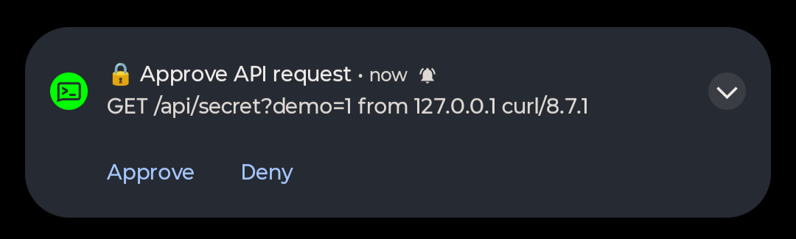

# ntfy-auth-gate

<p align="center">
  
</p>

Approve API requests from your phone. Drop the gate in front of any route, and each call holds until you tap Approve on an [ntfy](https://ntfy.sh) notification.

The caller sends no key and no password. It just calls the endpoint and waits, the same way a bank asks you to approve a login in its app. Works with Express, plain `node:http`, and anything built on Web `Request` and `Response` (Hono, Bun, Deno, Workers).

## How it works

1. A request hits a guarded route.
2. The gate sends you an ntfy notification with Approve and Deny buttons. It shows the method, path, client address and user agent.
3. The request stays open while it waits.
4. You tap a button. The phone posts your answer straight to ntfy, so your server needs no public address.
5. Approve runs your handler. Deny, timeout or an unreachable ntfy ends the request with an error and your handler never runs.

Each request gets its own random single-use response topic, so an answer can never be applied to a different request.

## Install

```sh
npm install ntfy-auth-gate
```

Requires Node 18 or newer. No runtime dependencies. Ships ESM and CommonJS with types.

## Set up your phone

You do this once.

1. **Install the ntfy app.**
   - Android: [Google Play](https://play.google.com/store/apps/details?id=io.heckel.ntfy) or [F-Droid](https://f-droid.org/packages/io.heckel.ntfy/)
   - iPhone: [App Store](https://apps.apple.com/us/app/ntfy/id1625396347)
   - No phone handy: the [web app](https://ntfy.sh/app) works too, but you only get alerts while the tab is open.
2. **Make a secret topic name.** The topic is the only thing protecting your approvals, so make it long and random. It can be up to 40 characters of letters, digits, dash and underscore.
   ```sh
   openssl rand -hex 16
   ```
3. **Subscribe to it in the app.** Tap the **+** button, paste the topic name, and tap **Subscribe**. Allow notifications when your phone asks. If you run your own ntfy server, turn on **Use another server** and enter its URL.
4. **Check that it works.** Run this from any terminal and your phone should buzz:
   ```sh
   curl -d "it works" ntfy.sh/YOUR_TOPIC
   ```
5. **Give the same topic to the gate.** Keep it in an environment variable, not in your code:
   ```sh
   export NTFY_TOPIC=YOUR_TOPIC
   ```
   ```js
   const gate = createGate({ topic: process.env.NTFY_TOPIC });
   ```

When a guarded route is called, the notification shows up with **Approve** and **Deny** buttons. You can answer straight from the notification without opening the app. If you self-host ntfy and use an iPhone, set `upstream-base-url: https://ntfy.sh` on your server so instant delivery works.

## Usage

### Express

```js
import express from "express";
import { createGate } from "ntfy-auth-gate";

const gate = createGate({ topic: process.env.NTFY_TOPIC });

const app = express();
app.get("/token", gate.middleware, (req, res) => res.json({ token: "abc" }));
app.listen(3000);
```

Works the same with Connect, Polka, Restify and anything else that uses `(req, res, next)`.

### Plain node:http

```js
import http from "node:http";
import { createGate } from "ntfy-auth-gate";

const gate = createGate({ topic: process.env.NTFY_TOPIC });

http
  .createServer(gate.wrap((req, res) => res.end("approved\n")))
  .listen(3000);
```

### Web Request and Response handlers

```js
import { createGate } from "ntfy-auth-gate";

const gate = createGate({ topic: process.env.NTFY_TOPIC });

export default {
  fetch: gate.guardFetch(async (request, env) => new Response("approved")),
};
```

Extra arguments such as `env` and `ctx` are passed through to your handler.

### Without an adapter

```js
const decision = await gate.approve({ title: "Deploy", message: "Ship v2 to prod?" });
if (decision.approved) deploy();
```

`decision` is `{ approved: boolean, reason: "approved" | "denied" | "timeout" | "aborted" }`.

Then call it like any other endpoint, and approve on your phone:

```sh
curl -s https://api.example.com/token
```

## Options

| option | default | description |
| --- | --- | --- |
| `topic` | required | ntfy topic that receives approval requests. Up to 40 characters of letters, digits, dash and underscore. |
| `server` | `https://ntfy.sh` | ntfy server URL. Use your own for privacy. |
| `token` | none | ntfy access token, sent as a bearer token when publishing and subscribing. |
| `actionHeaders` | none | headers the phone sends when you tap a button, for servers that require auth to publish. |
| `timeoutMs` | `60000` | how long to wait for an answer before giving up. |
| `maxPending` | `3` | most approvals allowed to wait at once. More are refused with 429. |
| `priority` | `4` | ntfy priority from 1 to 5. |
| `describe` | built in | `(subject) => ({ title, message, tags?, click? })` to customize the notification. `subject` has `method`, `url`, `ip` and `userAgent`. |
| `fetch` | `globalThis.fetch` | custom fetch implementation. |

## Responses

| outcome | status | body |
| --- | --- | --- |
| approved | handler runs | your response |
| denied | 403 | `{"error":"denied"}` |
| timeout | 408 | `{"error":"timeout"}` |
| too many pending | 429 | `{"error":"tooManyPending"}` |
| ntfy unreachable | 502 | `{"error":"unavailable"}` |

The gate fails closed. If the notification cannot be sent, nothing is let through. When the client disconnects, the pending approval is dropped.

Errors from `gate.approve` are `GateError` instances with a `code` of `publishFailed`, `subscribeFailed` or `tooManyPending`.

## Security notes

- Tap to approve means anyone who can publish to the per-request response topic can approve it. That topic is random, but it is visible to anyone who can read your notification topic. Treat the notification topic as a secret.
- On public ntfy.sh, anyone who learns your topic name can read the notifications and approve them. Use a long random topic, or self-host ntfy with access control and pass `token`.
- For a protected server, give the phone a write-only token scoped to the response topics and pass it as `actionHeaders`. Anyone who sees the notification can read those headers.
- The notification contains the request path, client address and user agent. Do not put secrets in URLs.
- Addresses come from the socket, or from `req.ip` when your framework sets it. Behind a proxy, configure trust proxy so the address is real.
- Anyone who can reach your endpoint can trigger a notification. `maxPending` and the timeout limit the noise, and a reverse proxy rate limit is a good addition.

## Development

```sh
npm install
npm run build
npm run check
npm test
```

## License

MIT
